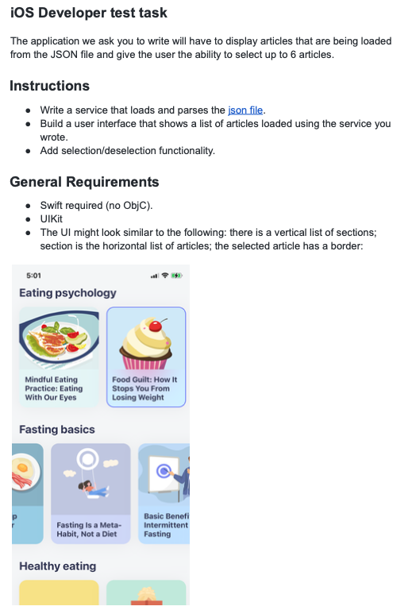

# Food

## О проекте

Пример iOS-интерфейса на Swift и UIKit, 2023 год. Логика подготовки данных вынесена в Presenter.

Точки входа для просмотра: `Food/Modules/Main/MainPresenter.swift`, `Food/Modules/Main/MainViewController.swift`, `Food/Services/LoaderJson.swift`.

Это исторический пример iOS/Android-кода. Основное текущее направление — Flutter / Dart; актуальный открытый Flutter-проект — [Objectno](https://github.com/nskomega/Objectno).

## Исходные материалы

